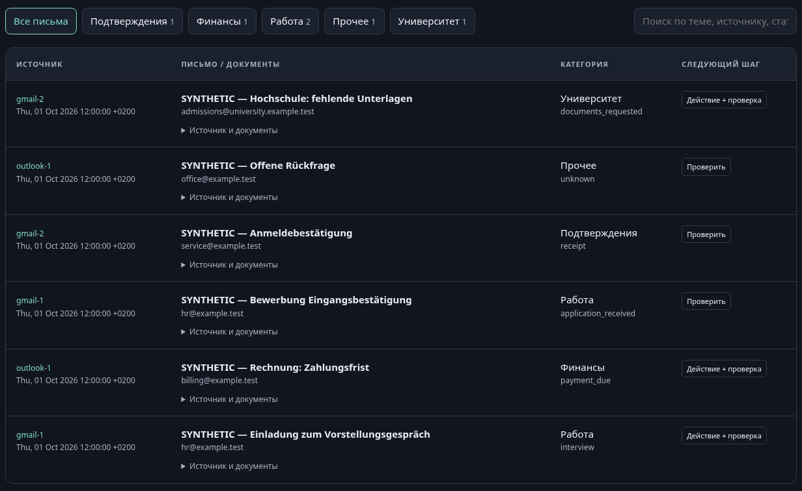
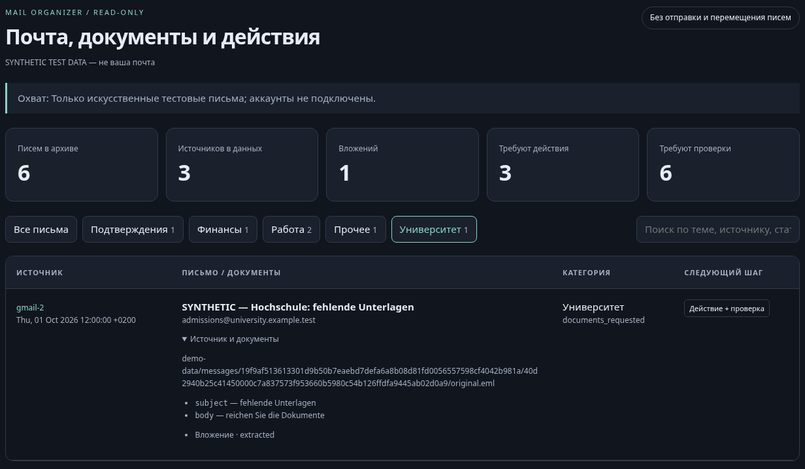

# Mail Organizer — два Gmail и один Outlook

[](https://github.com/egordziuba/mail-organizer/actions/workflows/tests.yml)

Рабочая первая версия локального read-only конвейера. Это **не полностью подключённая автоматизация**: авторизация реальных трёх ящиков, качество конкретной малой модели и запись в выбранный календарь ещё не проверены.

## Что реализовано

- Импорт настоящего `.eml` и неизменяемый локальный архив оригинала, текста и вложений с SHA-256 и SQLite-индексом.
- Разделение источников по account ID, защита от дубликатов и конфликта одного ID с разным оригиналом.
- Консервативные правила сортировки DE/EN/RU/UK: темы, наблюдаемые подтипы, необходимые действия и очередь проверки. Правила не заменяют смысловую проверку переписки.
- Локальный HTML-отчёт: программные показатели, категории, поиск, происхождение и документы. Фильтры и поиск работают без сети.
- GET-only Gmail API / Microsoft Graph коннекторы, pagination в пределах заданного лимита, запрет отправки bearer-токена на чужой host и через redirect, ограниченные retries.
- Раздельная OAuth-авторизация Gmail-1, Gmail-2 и Outlook-1 с хранением токенов в Windows Credential Vault; чужие настройки Hermes не изменяются. Авторизация открывает браузер только по явной команде `auth`.
- Экспорт узких заданий для модели и импорт структурированных ответов как **предложений**, не действий. Проверяются схема, task ID, актуальность источника, цитаты и исходное выражение даты. Пакет ошибочных ответов не применяется частично.
- На этой версии **нет SMTP, отправки писем, перемещения/удаления, изменения меток и записи в календарь**.




Искусственный пример: фильтры разбора и происхождение письма; все адреса используют `example.test`.

## Быстрый запуск — 4 шага

1. Открыть терминал в папке проекта. В архиве поставки виртуальное окружение отсутствует; создать своё:
   ```bash
   uv venv --python 3.11 .venv
   uv pip install --python .venv/Scripts/python.exe -e '.[auth,test]'
   ```
2. Проверить тесты:
   ```bash
   .venv/Scripts/python.exe -m pytest -q
   ```
   `python -E -X utf8 -m pytest -q` — 297 тестов: на Linux 287 пройдено, 10 пропущено. Проект ориентирован на Windows (Credential Vault, Task Scheduler, контроль процессов); тесты только для Windows пропускаются в других ОС.
3. Запустить искусственный сквозной пример:
   ```bash
   .venv/Scripts/python.exe -m mailorganizer.cli demo --root demo-data
   ```
4. Открыть `demo-data/report.html` в браузере. Надпись **SYNTHETIC TEST DATA** означает, что это не реальные письма. Повторный запуск оставляет шесть записей, а не удваивает их. Не использовать `demo-data` для реальной почты.

У установленного проекта также есть команда `mail-organizer` в `.venv/Scripts/`.

## Локальный импорт письма

```bash
.venv/Scripts/python.exe -m mailorganizer.cli import-eml --root local-mail --input 'C:/path/to/message.eml' --account gmail-1
.venv/Scripts/python.exe -m mailorganizer.cli report --root local-mail
```

Импорт не меняет исходный файл или серверный ящик. Лимит одного `.eml` на CLI — 50 MB. Сканированные PDF и неподдержанные типы не выдаются за распознанные: статус извлечения остаётся видимым. В зависимости от установленных библиотек часть PDF/DOCX может быть доступна для текстового извлечения; полноценный OCR не реализован.

## Подключение двух Gmail

Нужен Google OAuth client типа **Desktop app** с разрешённым Gmail API. Один client можно использовать для двух отдельных авторизаций. При testing consent оба пользователя должны быть допущены как test users. Политики Google/Workspace могут блокировать consent; не обещается обход ограничений.

Существующий путь клиента в окружении пользователя: `%LOCALAPPDATA%/hermes/google_client_secret.json`. Здесь он указан как возможный входной файл, **не проверенный новый consent**. Исходный `google_token.json` не используется и не изменяется: его прежняя refresh-проверка завершилась ошибкой.

```bash
.venv/Scripts/python.exe -m mailorganizer.cli auth --account gmail-1 --client-file 'C:/path/to/google-desktop-client.json'
.venv/Scripts/python.exe -m mailorganizer.cli auth --account gmail-2 --client-file 'C:/path/to/google-desktop-client.json'
```

В открывшемся браузере самостоятельно выбрать нужный аккаунт и пройти согласие. В чат не передавать пароль, код 2FA, redirect с authorization code или содержимое credential JSON. Запрашивается только `gmail.readonly`; отправка и изменение почты не разрешены. У каждого slot отдельный vault cache. CLI синхронизации также отвергает попытку считать один mailbox двумя источниками.

## Подключение Outlook

Нужна зарегистрированная Microsoft public-client desktop OAuth application с localhost redirect и поддержкой фактического типа аккаунта. Для личного Outlook нужен разрешённый personal-account audience. Рабочий/учебный Microsoft 365 может потребовать согласование администратора.

Application client ID — публичный идентификатор приложения, не пароль или client secret. Client secret для public client не нужен.

```bash
.venv/Scripts/python.exe -m mailorganizer.cli auth --account outlook-1 --client-id PUBLIC_APPLICATION_CLIENT_ID
```

Для чтения почты нужен `Mail.Read`; для проверки собственной identity через `/me` нужен `User.Read`. Эти разрешения должны быть включены в запрос авторизации. `Mail.Send`, `Mail.ReadWrite`, application-wide access и календарные полномочия не запрашиваются.

Подключать Gmail в настольный Outlook для работы этого механизма не требуется.

## Проверка статуса и ограниченная выгрузка

```bash
.venv/Scripts/python.exe -m mailorganizer.cli status --account gmail-1
.venv/Scripts/python.exe -m mailorganizer.cli status --account gmail-2
.venv/Scripts/python.exe -m mailorganizer.cli status --account outlook-1
```

`authorized` означает наличие отдельного локального cache, **не** подтверждённое живое подключение. Поэтому `live_verified` у `status` остаётся `false`. Настоящую identity и доступ проверяет `sync`.

```bash
.venv/Scripts/python.exe -m mailorganizer.cli sync --root real-mail --account gmail-1 --query 'newer_than:90d' --max-messages 100
.venv/Scripts/python.exe -m mailorganizer.cli sync --root real-mail --account gmail-2 --query 'newer_than:90d' --max-messages 100
.venv/Scripts/python.exe -m mailorganizer.cli sync --root real-mail --account outlook-1 --client-id PUBLIC_APPLICATION_CLIENT_ID --folder inbox --max-messages 100
.venv/Scripts/python.exe -m mailorganizer.cli report --root real-mail
```

Это **пилотный ограниченный проход**, а не полная выгрузка трёх ящиков. `newer_than:90d` указан явно в примере; пустой query не ограничивает период. Gmail по умолчанию не включает Spam/Trash, Graph по умолчанию читает только Inbox. `--max-messages` — предохранительный лимит. В `sync_status.json` сохраняются scope, лимит, счётчики и `full_mailbox_verified=false`; сбой после части загрузки остаётся `failed_partial`, а не успехом.

Повторный запуск на тех же сообщениях дедуплицируется. Скрытый worker, периодические ограниченные проходы и автоподъём Windows теперь реализованы — см. `RUNBOOK.md`. Но **durable delta/history cursor и автоматический полный backfill всех папок пока не реализованы**. Новая версия не должна называться полной/incremental, пока это не проверено отдельно.

## Работа с менее мощной моделью

В этой версии модель не вызывается автоматически и содержимое почты никуда не отправляется. Экспортируется локальный JSONL-файл заданий:

```bash
.venv/Scripts/python.exe -m mailorganizer.cli tasks --root real-mail
```

`model_tasks.jsonl` содержит одну небольшую задачу на письмо: instruction, input, task ID и expected_output. `tools=[]`, тело ограничено 12 000 символами. Длинные письма не обрезаются молча: они попадают в `model_task_review.json`; chunking ещё не реализован. Security-письма исключены, URL и цифровые коды маскируются. Это базовая защита, не гарантия удаления любого персонального/секретного текста. Перед передачей реальной почты внешнему провайдеру нужен согласованный privacy policy и проверка данных.

Поставщик/модель могут меняться без изменения архивирования. Модель должна вернуть только объект по `expected_output`:
- `task_id` неизменен;
- `topic` — `university`, `jobs`, `finance`, `confirmations`, `housing`, `security`, `other`;
- `subtype` — короткий тип или `unknown`;
- `action_required` / `needs_review` — настоящие JSON boolean;
- `reason` — строка;
- `evidence` — `source_id` равен `subject` или `body`, `quote` точно присутствует в переданном тексте;
- `date_candidate` — null либо `{source_id, quote, raw}`, где raw действительно содержится в quote. Это **не нормализованное календарное время**.

Импортировать локально сохранённые ответы (JSONL или JSON array):

```bash
.venv/Scripts/python.exe -m mailorganizer.cli validate-results --root real-mail --input 'C:/path/to/model-results.jsonl'
.venv/Scripts/python.exe -m mailorganizer.cli report --root real-mail
```

Выдуманная цитата/чужой или устаревший task ID/лишняя команда/неправильная дата отклоняются. Принятый результат хранится в `model_proposals.json` с `state=proposed` и `calendar_write_allowed=false`. Точное совпадение цитаты подтверждает источник, **не истинность смысловой трактовки**. Нет измеренной точности конкретной модели; её нужно проверять на размеченной реальной выборке.

## Календарь: граница первой версии

Кандидаты сроков и встреч можно хранить в модельных предложениях. Внешний календарь не подключён, нет создания/обновления/удаления событий или приглашений.

Следующий этап требует выбора календаря и отдельного consent, нормализации времени/таймзоны, дедупликации с существующими приглашениями, preview → approval exact payload → write → GET/read-back. Для Outlook событие имеет одно нативное напоминание; политика нескольких напоминаний должна учитывать возможности провайдера.

## Что ещё нужно довести до полного запроса

1. Авторизовать и проверить именно три реальных mailbox.
2. Реализовать полный backfill и устойчивую Gmail history / Graph per-folder delta-синхронизацию, покрытие папок и восстановление.
3. Добавить реестр вакансий/университетских дел и подтверждённые переходы статусов по целой переписке.
4. Довести обработку документов/OCR и ограниченную модельную эскалацию; измерить ошибки на реальной почте.
5. Подключить выбранный календарь и проверить один разрешённый live E2E с напоминанием.
6. Только после этого включить расписание и уведомления о новых действиях.

Архив содержит персональные письма: он локальный, но не шифруется автоматически целиком. Используйте собственный защищённый диск/учётную запись, согласуйте retention и backup. Экспортные файлы и отчёты не публиковать в публичный git/cloud.

## Официальные источники

- https://developers.google.com/workspace/gmail/api/auth/scopes
- https://learn.microsoft.com/en-us/graph/api/message-delta?view=graph-rest-1.0
- https://learn.microsoft.com/en-us/graph/permissions-reference
- https://learn.microsoft.com/en-us/graph/api/user-get?view=graph-rest-1.0
- https://learn.microsoft.com/en-us/graph/outlook-immutable-id

